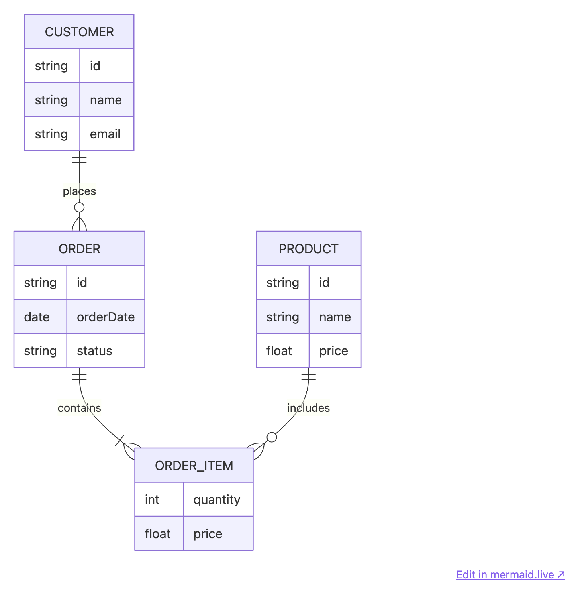
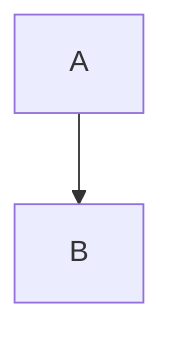

# Mermaid Live Link

An [Obsidian](https://obsidian.md) plugin that adds an **Edit in mermaid.live ↗** link beneath every Mermaid diagram, in both Live Preview and Reading view. One click opens the diagram in the [Mermaid Live Editor](https://mermaid.live) with its code preloaded.



It also ships styles that keep diagrams at a sensible width and make them print cleanly:

- Diagrams scale to fit the note width instead of scrolling (and to at most 600 px wide in print).
- When exporting to PDF, a diagram is never split across pages, never stranded below its headline, and is capped to fit one page.
- The mermaid.live link is hidden in print and PDF export.

## Installation

### Manual

1. Download `main.js`, `manifest.json` and `styles.css` from the [latest release](../../releases/latest).
2. Copy them to `<your vault>/.obsidian/plugins/mermaid-live-link/`.
3. Reload Obsidian and enable **Mermaid Live Link** under Settings → Community plugins.

### BRAT

Add this repository in the [BRAT](https://github.com/TfTHacker/obsidian42-brat) plugin.

## Usage

Write a Mermaid code block as usual:

````markdown

````

The link appears below the rendered diagram, including diagrams inside callouts, lists and embedded notes. The diagram opens in mermaid.live with the dark theme when Obsidian uses a dark theme.

## Privacy

The plugin makes no network requests. The diagram code is encoded into the link's URL and is only sent to mermaid.live if you click the link. This is why the code uses `btoa` (base64 encoding): it is the URL format mermaid.live expects.

## Development

There is no build step: `main.js` is plain JavaScript. To try changes, symlink or copy this folder into `<vault>/.obsidian/plugins/mermaid-live-link/` and reload the plugin.

### Releasing

```sh
npm version patch   # or minor / major; updates manifest.json and versions.json
git push --follow-tags
```

Pushing the tag triggers the GitHub Action, which publishes a release with `main.js`, `manifest.json` and `styles.css` attached, along with GitHub artifact attestations for them. The tag must equal the version in `manifest.json` (no leading `v`).

## License

[MIT](LICENSE)
